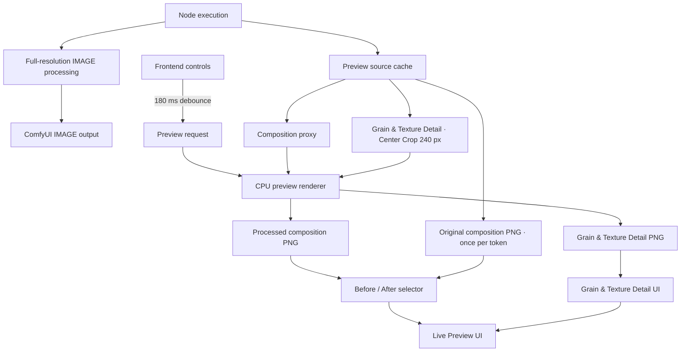

# Zuanfilm Retrolab

**Analog character. Digital precision. Built for the AI age.**

Zuanfilm Retrolab is a post-rendering photographic finishing node for ComfyUI, inspired by analog film development and reimagined for the age of artificial intelligence.

Bring photographic texture, expressive light behavior, tonal reversal and optical finishing to rendered images—directly inside your ComfyUI workflow. The node also includes an Anti-AI normalization control and a deterministic procedural micro-texture selector for tuning over-processed AI renders and exploring distinct surface character.


*Zuanfilm Retrolab in a real ComfyUI workflow, showing the original
photograph, creative controls and finished result.*

## At a glance

- **Twelve finishing stages**, including a 50-look Color Film Emulsions Atlas, deterministic procedural texture and Film Grain, plus independent White Balance, Anti-AI and Exposure corrections in one creative node.
- **Live Preview** that fills the node, with a draggable Before / After split and a native-resolution **Grain & Texture Detail** loupe. Controls are grouped into six tabs (Color, Light, Tone, Leak, Optics, Grain) so the node stays compact.
- **Zuanfilm Retrolab Video** node for frame batches: the same controls with a live player (play/pause, frame scrubber, 8–30 fps). The preview keeps only a 384 px uint8 proxy of up to 240 sampled frames on the CPU, and renders the frame under the playhead first after every change.
- **Ten interface languages:** English, Simplified Chinese, Japanese, Spanish, Portuguese, French, Russian, German, Hindi and Arabic.
- **Independent deterministic seeds** for procedural texture, Film Grain and Light Leak geometry.
- **Automatic hardware adaptation:** sufficiently large workloads can use available NVIDIA CUDA acceleration without any device controls in the creative interface; CPU-only PyTorch remains supported.
- **Photographic precision:** float32 internal calculations, with input dtype, batch, additional channels and normal output-device behavior preserved. A CUDA allocation failure retries the full batch on CPU.
- **Execution Report output:** an optional-to-connect text socket returns structured JSON with the chosen processing route, CUDA availability, GPU/VRAM information, workload, timing and any CPU fallback reason. Reports are returned through the workflow only; Retrolab never writes diagnostic files automatically.
- **No extra Python packages** beyond the ComfyUI runtime.

## The finishing pipeline

Retrolab applies White Balance, Anti-AI normalization and Exposure first, then processes each image through a deliberate finishing sequence. Light and exposure effects are shaped next, followed by the selected film-emulsion response, tonal and optical treatments, procedural micro-texture and finally Film Grain.


| Order | Stage | What it contributes |
|---:|---|---|
| 00 | **White Balance** | Primary cool/warm and green/magenta correction before creative finishing |
| 01 | **Anti-AI** | Deterministic tonal and chroma normalization for over-processed AI renders |
| 02 | **Exposure** | Smooth lightness adjustment toward black or white |
| 03 | **Bloom** | Soft-knee highlight extraction and multi-scale optical glow |
| 04 | **Halation** | Annular highlight response with an adjustable emission color |
| 05 | **Light Leak** | Deterministic edge-light patterns, color and inward propagation |
| 06 | **Color Film Emulsion** | A selectable color/tonal response from the 50-look cinema, instant, slide and 35mm atlas |
| 07 | **Sabattier** | Non-monotonic highlight reversal and tonal confinement |
| 08 | **Soft Focus** | Center-preserving blur that increases smoothly toward the corners |
| 09 | **Vignette** | Aspect-correct radial exposure falloff |
| 10 | **Procedural Texture** | Seeded image-space noise families for controlled micro-texture |
| 11 | **Film Grain** | Seeded photographic grain with luminance-aware and color-grain control |

All finishing stages are independently adjustable. Anti-AI, Exposure and Procedural Texture default to zero contribution; White Balance defaults to its centered neutral position; and the emulsion selector defaults to Neutral. A new node therefore starts with an exact identity output. When every effect and correction is bypassed, Retrolab returns the original input tensor directly without image arithmetic or color conversion.

## Color Film Emulsions Atlas

The **Color Film Emulsion** selector sits directly below Live Preview, beside the Emulsion Response stepper. It contains **50 creative film looks plus Neutral**, organized into four families:

| Family | Profiles | Creative references |
|---|---:|---|
| Cinema / motion-picture negative | 10 | Kodak VISION3 50D / 250D / 200T / 500T, VERITA 200D and CineStill-inspired daylight / tungsten looks |
| Instant film | 10 | Polaroid SX-70, 600, i-Type, 669, Time-Zero and 690; Fujifilm instax Mini / SQUARE / WIDE and FP-100C |
| Slide / reversal | 10 | Ektachrome, Velvia, Provia, Astia, Sensia, Kodachrome-inspired and Agfachrome-inspired looks |
| 35mm color negative | 20 | Portra, Ektar, Gold, ColorPlus, UltraMax, Kodacolor, Fujicolor, Superia, PRO 400H, Natura, Lomography and Ektacolor PRO references |

The dropdown is grouped by film family and starts at **Neutral · No emulsion**. Neutral is an exact identity bypass. The 50 looks cover distinct tonal/color directions: restrained portrait palettes, warm consumer-negative color, vivid slide saturation, cooler tungsten cinema balance, instant-film softness and more contrast-forward looks.

The profiles are original, independently authored creative RGB transforms. Their names identify the film stocks and families used as public reference vocabulary; they are **not claims of spectrally calibrated, sensitometric, chemical or scanner-exact reproduction**. The transform uses exposure, a smooth luminance curve, saturation, channel balance and separate shadow/highlight color biases in linear RGB. It does not synthesize grain. Film Grain remains a separate engine with its own Amount, Size and Color Grain controls, so an emulsion choice never silently changes texture settings.

The atlas is intended to provide accessible, recognizable starting points for creative finishing. Product and stock names remain the property of their respective owners; Zuanfilm Retrolab is an independent tool and is not affiliated with or endorsed by those manufacturers.

### Emulsion Response

The **Emulsion Response** stepper (−/+ in 0.05 steps; double-click the value to return to 1.00×) controls how strongly the selected film profile expresses its complete tonal and color signature. It ranges from **0.50× to 3.00×**, with **1.00×** as the default. At 1.00× the original profile is preserved exactly; lower values soften its deviation from the image entering the emulsion stage, while higher values amplify it. The response is applied around the stage input in linear RGB, rather than acting as a global saturation or contrast adjustment. **Neutral** remains an exact identity bypass regardless of the slider value. Emulsion Response does not change grain or procedural texture, and the Grain & Texture Detail preview remains independent of the emulsion processing stage. Existing workflows receive the 1.00× default, preserving their previous appearance.

### Atlas entries

**Cinema / motion-picture negative (10)**

Kodak VISION3 50D · Kodak VISION3 250D · Kodak VISION3 200T · Kodak VISION3 500T · Kodak VISION3 500T Push · Kodak VERITA 200D · CineStill 50D · CineStill 400D · CineStill 800T · CineStill 800T Night

**Instant film (10)**

Polaroid SX-70 Color · Polaroid 600 Color · Polaroid i-Type Color · Polaroid 669 Packfilm · Polaroid Time-Zero · Polaroid 690 Color · Fujifilm instax mini · Fujifilm instax SQUARE · Fujifilm instax WIDE · Fujifilm FP-100C

**Slide / reversal (10)**

Kodak Ektachrome E100 · Kodak Ektachrome 100D · Fujichrome Velvia 50 · Fujichrome Velvia 100 · Fujichrome Provia 100F · Fujichrome Astia 100F · Fujichrome Sensia 100 · Fujichrome Sensia 400 · Kodachrome 64 Archive · Agfachrome RSX 100

**35mm color negative (20)**

Kodak Portra 160 · Kodak Portra 400 · Kodak Portra 800 · Kodak Ektar 100 · Kodak Gold 200 · Kodak ColorPlus 200 · Kodak UltraMax 400 · Kodak Kodacolor 100 · Kodak Kodacolor 200 · Fujicolor 400 · Fujicolor Superia X-TRA 400 · Fujicolor Superia Reala · Fujicolor PRO 400H · Fujicolor Natura 1600 · Fujicolor Superia 800 · Lomography Color Negative 100 · Lomography Color Negative 400 · Lomography Color Negative 800 · Kodak Ektacolor Pro 160 · Kodak Ektacolor Pro 400


## White Balance gain wheel

The **Color** tab contains a Resolve-inspired two-axis gain wheel. Drag the puck inside the circle or use the arrow keys:

| Axis | Negative direction | Positive direction | Range |
|---|---|---|---:|
| Vertical · Temperature | Cool | Warm | -1 to +1 |
| Horizontal · Tint | Green | Magenta | -1 to +1 |

The center is the input's **Base WB**. The **Base WB** button returns both axes to zero; this is a manual reset and does not analyze or automatically white-balance the image. White Balance is a primary source correction: Retrolab converts the input sRGB values to linear RGB, applies restrained channel gains, normalizes the gain against Rec.709 luminance, and then converts back to sRGB before the creative finishing stages. It changes the rendered color balance without silently changing emulsion, grain or light-effect settings.

This is an interactive creative temperature/tint correction inspired by color-grading wheels. Both axes default to zero, which is an exact identity bypass. The control is part of the processed After preview and full-resolution IMAGE output; the Before preview remains the untouched source, and the **Grain & Texture Detail** view remains a dedicated source-scale inspection of Procedural Texture followed by Film Grain.

## Anti-AI normalization

The **Anti-AI** control is a deterministic 0–100% correction (default 0%) intended to bring common AI-render excesses toward a more natural photographic balance. Its smooth global response gently compresses contrast, reduces red/orange chroma, softens the black toe, opens midtones and rolls highlights more gradually. It is a photographic finishing correction, not an AI detector, local retouching system or a promise that every image requires correction. At zero it is an exact bypass.


## Exposure

The **Exposure** slider sits directly below Anti-AI **Strength**. It ranges from -100 to +100, with 0 as an exact bypass. Negative values retain the established linear darkening response in linear-light RGB; -100 leaves 5% of the source linear-light intensity. Positive values use a gradual 2.5-power ease-in curve to provide finer control through low and middle settings, progressively moving linear-light RGB toward white; +100 reaches 95% of the remaining distance to white. The adjustment is applied before Bloom and the other creative light effects so those stages respond to the corrected lightness.

This is a normalized photographic lightness control rather than an EV-based camera exposure setting.

## Creative controls

The **Bloom** and **Halation** controls provide separate optical highlight treatments, with the Halation Color picker grouped alongside its controls.

### Film Grain

| Control | Range | Default | Description |
|---|---:|---:|---|
| Amount | 0–3 | 0 | Grain strength, including stronger creative settings above 1 |
| Size | 0.1–4.0 | 0.3 | Correlation radius in reference pixels at a 1024 px long edge; lower values create finer, less-correlated grain |
| Color Grain | 0–1 | 0.09 | Blends shared luminance grain and independent RGB grain |
| Grain Blend Mode | 12 modes | Additive | Selects how the signed grain carrier interacts with image tones |

Grain is generated from a counter-based hash of pixel coordinates, channel stream, a fixed internal grain seed and batch-frame index. The same input, settings and runtime produce repeatable grain. Batch frames receive deterministic variation. The user-facing **Light Leak Seed** and **Noise Seed** do not alter Film Grain; grain keeps its own independent fixed seed. **Grain Blend Mode** offers the same twelve compositing choices as Texture Blend Mode. **Additive** is the default and preserves the established Film Grain response; the other modes apply the same shared signed-carrier compositing philosophy to the grain layer.

### Procedural Texture

Procedural Texture is an independent, deterministic image-space texture stage. It is separate from Film Grain: the selected kernel defines the surface character, **Noise Amount** controls its visibility, **Noise Seed** selects a repeatable realization and **Texture Scale** controls feature size relative to the source image. Noise Amount ranges from 0 to 2 (default 0), providing twice the previous maximum contribution while preserving the original response throughout the existing 0–1 range; Noise Seed is an integer slider from 0–999 (default 73); Texture Scale ranges from 0–4.0 (default 1.0). Zero selects the finest supported sampling interval; higher scale values create broader marks, while lower values create finer detail. The **Texture Blend Mode** selector offers twelve choices. **Additive** is the default and preserves the preceding release’s subtle texture response; all other modes provide a different tonal interaction between the procedural layer and the image:

| Blend mode | Tonal interaction |
|---|---|
| **Additive** | Adds the signed texture field to the image. |
| **Multiply** | Applies a neutral-centered multiplicative modulation. |
| **Screen** | Applies a neutral-centered screen-style brightening response. |
| **Overlay** | Combines multiply-like shadows and screen-like highlights. |
| **Soft Light** | Applies a gentler, lower-contrast overlay response. |
| **Hard Light** | Applies a stronger thresholded overlay response. |
| **Color Dodge** | Brightens according to the texture carrier. |
| **Color Burn** | Darkens according to the texture carrier. |
| **Lighten** | Retains the lighter result at each channel. |
| **Darken** | Retains the darker result at each channel. |
| **Difference** | Uses an absolute-difference response. |
| **Exclusion** | Applies a softened difference-style interaction. |

Changing Noise Seed does not change Light Leak geometry or Film Grain.

| Texture | Character |
|---|---|
| **Gaussian** | Fine Gaussian-distributed microtexture sampled from absolute source-pixel coordinates |
| **Value fBm** | Smooth value-lattice noise accumulated across multiple octaves |
| **Gradient fBm** | Perlin-style gradient noise with multi-scale structure |
| **Simplex fBm** | Simplex-gradient noise with layered spatial scales |
| **Ridged fBm** | Ridge-shaped fractal response for stronger structured texture |
| **Worley Microcells** | Cellular feature-point texture with small cell-scale variation |
| **Domain Warp** | Multi-scale noise with deterministic coordinate displacement |
| **Silver Halide Clumps** | Fine granular carrier modulated by broad irregular clusters to evoke clumped silver-halide structure |
| **Emulsion Mottle** | Layered broad, middle and fine noise for uneven emulsion density |
| **Film Scratches** | Sparse, irregular near-vertical scratches with broken longitudinal edges |
| **Dust & Fibers** | Isolated specks and fine elongated fibres suspended on the image surface |
| **Paper Foxing** | Uneven clustered stains with small pores and a restrained warm ochre discolouration |

The twelve kernels are bounded, deterministic 2D image-texture adaptations. All kernels use source-image-relative coordinates, so Texture Scale remains meaningful across resolutions and the native-detail crop aligns with the same region of the full image. Noise is applied after optical finishing and before Film Grain, so Film Grain remains the final texture layer.

### Halation

| Control | Range | Default | Description |
|---|---:|---:|---|
| Amount | 0–2 | 0 | Strength of the annular highlight response |
| Ring Radius | 3–60 | 8 | Annular response radius in reference pixels at a 1024 px long edge |
| Halation Color | Hex color | `#FF9959` | Emission tint; the default preserves the established warm red-dominant response |

The halation engine combines an annular kernel with an outward scattering tail. Color selects the normalized linear-RGB emission tint and does not change the Amount control.

### Bloom

| Control | Range | Default | Description |
|---|---:|---:|---|
| Amount | 0–3 | 0 | Optical highlight glow strength |
| Threshold | 0–0.98 | 0.1 | Linear-luminance level where highlight extraction begins |
| Radius | 1–40 | 8 | Bloom core radius in reference pixels at a 1024 px long edge |

Bloom uses a soft-knee highlight extraction followed by multi-scale blur. A zero-threshold black-frame guard prevents pure black pixels from producing an artificial glow.

### Sabattier

| Control | Range | Default | Description |
|---|---:|---:|---|
| Solarization | 0–1 | 0 | Depth of the non-monotonic tonal reversal |
| Highlight Confinement | 0–1 | 0.09 | Controls how far the reversal extends from highlights into midtones |

The engine evaluates linear Rec.709 luminance and recombines the result with a shared RGB ratio to retain the source color relationship. A legacy Mackie Lines backend field remains hidden from the visible interface.

### Light Leak

| Control | Range | Default | Description |
|---|---:|---:|---|
| Light Leak Mode | Five modes | Soft Edge | Selects the leak geometry |
| Leak Position | Eight edge/corner positions | Bottom | Sets the entry edge or corner |
| Exposure | 0–10 | 0 | Additional incident-light exposure |
| Light Leak Seed | 0–999 | 27 | Deterministic seed slider for Light Leak geometry only |
| Influence Radius | 0.25–10 | 1 | Scales inward propagation and spectral attenuation |
| Leak Color | Hex color | `#C2AF8E` | Incident-light spectrum |

Available modes:

- **Soft Edge** — broad, organic edge intrusion with low-frequency boundary variation.
- **First-Frame Burn** — concentrated exposure with a near-white entry core and colored falloff.
- **120 Fat Roll** — wavy edge bands inspired by loose medium-format backing-paper winding.
- **Light Piping** — narrow irregular channels with a broader veil extending inward.
- **Holga 135** — diffusing perforation-shaped exposure marks inspired by 35 mm film edges.

The selected leak geometry remains fixed across batch frames to avoid spatial flicker. Light Leak Seed changes only this geometry; Procedural Texture and Film Grain use separate seeds / seed behavior. Influence Radius scales the inward reach of the selected mode; 1.0 preserves the established footprint, while larger values can extend influence toward the opposite border.

### Soft Focus and Vignette

These controls are presented together as a compact two-column optical-finishing group.

| Engine | Control | Range | Default | Description |
|---|---|---:|---:|---|
| Soft Focus | Amount | 0–1 | 0 | Maximum blend of the blurred field at the corners |
| Soft Focus | Radius | 1–80 | 24 | Maximum Gaussian radius at the corners, in reference pixels at a 1024 px long edge |
| Vignette | Amount | 0–2 | 0 | Radial exposure reduction, up to 3 stops at the corners |
| Vignette | Feather | 0–1 | 0.65 | Controls the radial transition and how far the falloff reaches inward |

**Soft Focus** blurs the image in linear RGB, then blends the blurred field over the original using an aspect-correct radial mask. The exact center remains sharp; blur contribution grows smoothly toward the corners. It is not a uniform full-frame blur.

**Vignette** uses an aspect-ratio-correct radial distance field normalized from the image center to its corners. Its exposure multiplier is applied in linear RGB, creating a photographic falloff rather than a color overlay.

## Live Preview

After the first queued execution creates a preview source, the Live Preview appears at the top of the node and takes all spare node height; the control panels keep a fixed height, so resizing the node only grows the picture. The **Split / Before / After** switch on the preview compares the untouched input against the current processed composition; in Split mode, drag across the image to move the divider. The original comparison image is transferred once per preview token and retained in browser memory; slider changes update the processed image without retransmitting the original. The comparison switch is a frontend-only control and adds no ComfyUI workflow input. The initial queue is required to create the preview source; subsequent control adjustments refresh the previews without rerunning the workflow.

The panel provides two complementary inspection views:

- **Composition** — a reduced preview of the photographic finish with Film Grain bypassed, so downscaling does not exaggerate grain size.
- **Grain & Texture Detail · Center Crop 240 px** — a loupe in the preview's lower-right corner (hover to enlarge) showing a native-resolution center crop up to 240 × 240 px, processed with Procedural Texture followed by Film Grain so both texture layers can be inspected at source scale without downscaling.



Changing a control refreshes the processed composition and Grain & Texture Detail after a 180 ms debounce. Preview updates do not queue the workflow or rerun upstream nodes. The reduced composition preview renders White Balance, Anti-AI, Exposure, Bloom, Halation, Light Leak, Color Film Emulsion, Sabattier, Soft Focus and Vignette, while bypassing Procedural Texture and Film Grain so downscaling does not exaggerate their texture. The Before view displays the untouched reduced input; the After view displays the processed composition. The actual full-resolution ComfyUI IMAGE output applies both texture stages. Grain & Texture Detail applies Procedural Texture first and Film Grain second at source scale, using absolute source coordinates and a surrounding context margin.

The preview source is created during node execution. Queue the node again when the input image changes. Preview cache entries contain a reduced composition proxy and compact grain crop/context rather than a full-resolution source frame. The cache is CPU-resident, holds up to six entries and expires each entry after 30 minutes. If preview creation or rendering fails, the main IMAGE processing path remains available.

## Interface and localization

Below Live Preview, the Color Film Emulsion selector stays visible and six tabs show one control group at a time; a dot marks each tab with non-default settings, and the selected tab is saved with the workflow. The grouped emulsion menu is a viewport-level popup that opens below its trigger, keeping the preview unobscured while the profile list is browsed. Native color pickers are provided for Halation Color and Leak Color, alongside Reset to Defaults (↺) and the globe-icon language selector on the preview, translated Light Leak Mode and Leak Position selectors, and descriptive hover guidance. Parameter hover descriptions are localized in all ten languages. Procedural Texture and Film Grain each expose the shared twelve-mode blend family; the paired selectors sit together beneath their respective texture controls. New nodes receive a one-time zoom-aware initial width after construction, targeting a comfortable visible presentation while bounding the initial graph-space width; canvas zoom remains under LiteGraph control after creation, and manual resizing plus saved workflow dimensions remain authoritative without an enforced minimum.

Supported languages, in selector order:

1. English
2. Simplified Chinese
3. Japanese
4. Spanish
5. Portuguese
6. French
7. Russian
8. German
9. Hindi
10. Arabic

The language preference is stored in browser-local storage. It is not a ComfyUI input and is not written into workflow JSON. Translated Light Leak labels map to the canonical option values expected by the processing node.

## Image and processing contract

- **Input:** ComfyUI `IMAGE` tensor with shape `(B, H, W, C)`.
- **Outputs:** ComfyUI `IMAGE` plus a `STRING` execution report. The IMAGE retains the same batch, spatial dimensions, channel count and dtype. In normal operation it retains the input device. CPU-origin images remain CPU outputs even when their frames are internally processed on CUDA. If a CUDA-origin batch encounters an allocation failure and requires CPU recovery, its fallback output is CPU-resident.
- **Execution Report:** structured JSON containing the planner decision, actual processing device, CUDA availability and device name when queried, preflight VRAM and allocator snapshots when available, estimated per-frame working set, input/output tensor metadata, active finishing stages, full-resolution image-pipeline time, throughput and any CUDA-to-CPU recovery details. The report also includes the exact creative settings used for that run. Connect the `report` socket to a text display/output node and copy its contents when requesting technical support. The report is not automatically saved.
- The first three channels are processed as RGB. Additional channels pass through unchanged.
- Light and exposure operations use linear RGB where appropriate; Film Grain is applied in display-referred RGB.
- Batch frames are processed sequentially, with deterministic per-frame grain variation and preallocated output storage.
- CPU-origin images may be processed on CUDA one frame at a time when the image workload and available VRAM justify it. The completed frame is returned to the input's CPU output path. If CUDA is unavailable, occupied or runs out of memory, CPU execution remains available.
- The processing path uses PyTorch and PyTorch FFT operations. The preview endpoint uses the Pillow installation already provided by ComfyUI to encode its two small PNG previews.
- No device selector, CUDA toggle, VRAM control or performance mode is exposed to the user. No extra Python packages are required by the node.

This is a creative photographic finishing tool, not a complete per-stock chemical simulation or a general-purpose RAW development system. Its effects are physically inspired and artistically composed, with explicit implementation assumptions documented in [`docs/architecture.md`](docs/architecture.md).

## Installation

Zuanfilm Retrolab is published on the [Comfy Registry](https://registry.comfy.org/nodes/zuanfilm-retrolab) as **version 1.0.0**.

### Recommended: ComfyUI Manager

1. Open **ComfyUI Manager**.
2. Open **Install Custom Nodes** (or **Custom Nodes Manager**, depending on your Manager version).
3. Search for **Zuanfilm Retrolab**.
4. Select the Registry entry and install it.
5. Restart ComfyUI.

### Comfy CLI

You can also install the Registry package from a terminal using the command shown on its Registry page:

```bash
comfy node install zuanfilm-retrolab
```

Run the command in the ComfyUI workspace configured for your local installation, then restart ComfyUI.

### Manual GitHub installation

For a manual installation, clone the repository into your ComfyUI custom-nodes directory:

```bash
cd ComfyUI/custom_nodes
git clone https://github.com/zuanfilm/Zuanfilm-Retrolab.git
```

Restart ComfyUI after cloning.

Retrolab has no additional Python package dependencies beyond the PyTorch/Pillow runtime supplied by ComfyUI. It does not require model weights, API credentials or a separate CUDA configuration step. Its execution planner automatically selects CUDA when beneficial and supports CPU processing.

### First run: activate previews

After installing Retrolab and restarting ComfyUI, connect an input image and **queue the workflow once**. This first execution creates the preview source used by the Live Preview and Grain & Texture Detail panels. Until that initial run completes, the node displays a message asking you to queue it.

After the preview source has been created, changing Retrolab controls refreshes the previews automatically; you do not need to queue the workflow again for each adjustment. Queue the node again when you change the input image or when the preview source has expired or become unavailable.

## Example workflow

A functional example workflow and its input photograph are included in [`examples/`](examples/README.md):

- [Open the ComfyUI workflow](examples/workflows/Zuanfilm_Retrolab.json)
- [Use the sample input photograph](examples/images/Zuanfilm-A1213345.jpg)

Copy the sample photograph into `ComfyUI/input/` before opening the workflow. The Load Image node references the file by its included filename. The workflow demonstrates the Color Film Emulsion Atlas, Emulsion Response, optical finishing, Film Grain, Procedural Texture, Before/After comparison and image saving. See the [example instructions](examples/README.md) for details.

## Development and tests

From the repository root:

```bash
python -m unittest discover -s tests -v
node tests/test_frontend.mjs
```

The Python suite exercises the processing engines, node contract, preview cache and HTTP routes without requiring a running ComfyUI host. The frontend interaction test uses a mocked ComfyUI environment to verify DOM controls, localization, preview refresh and widget behavior. Host testing is required for the actual ComfyUI frontend and target GPU/runtime.

See:

- [`docs/architecture.md`](docs/architecture.md) — processing, data flow, rendering and preview architecture.
- [`docs/validation.md`](docs/validation.md) — automated validation record and host acceptance notes.
- [`docs/references.md`](docs/references.md) — technical references.

## License

Apache License, Version 2.0. See [`LICENSE`](LICENSE).
